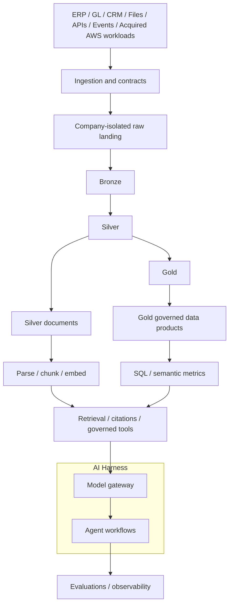

# Enterprise Data & AI Platform — Reference Implementation

A public, local-first learning and demonstration monorepo based on the accompanying Azure Enterprise Data Platform physical architecture and Enterprise AI Harness reference architecture.

> **Status:** Bootstrap / foundation. The smoke tests and example commands are runnable; cloud services, production governance, full RAG, and A2A are **not yet implemented**. Never represent the local demos as production Azure deployments.

## Architecture at a glance



**Target Azure physical architecture** (see `docs/architecture/azure-enterprise-data-platform.drawio`): Azure CAF Landing Zones, Entra ID, hub-spoke network, private connectivity, ADF/Event Hubs/API Management ingestion, company-isolated ADLS Gen2 landing, Azure Databricks + Delta Lake Bronze/Silver/Gold, Unity Catalog, packaged MDM, finance consolidation and reconciliation, Databricks SQL, Power BI, Microsoft Purview. Gold financial model starts with `Fact_GL_Transaction` (one posted journal line per row) and conformed Date, Company, Legal Entity, Account, Cost Center, and Currency dimensions; other facts retain separate grains.

**Local development substitutions:** Python + DuckDB + Parquet for data processing; local file-backed examples for the AI side. These are learning substitutions, **not** feature-equivalent replacements for Delta Lake, Unity Catalog, Purview, or enterprise identity. Cloud resources are documented targets, not provisioned.

## Repository layout

```text
.
├── README.md
├── requirements.txt                 # minimal bootstrap dependencies
├── .env.example                     # no secrets
├── .gitignore
├── data-platform/
│   ├── README.md
│   ├── requirements.txt
│   ├── src/data_platform/
│   ├── tests/
│   └── data/sample/
├── ai-platform/
│   ├── README.md
│   ├── requirements.txt
│   ├── src/ai_platform/
│   └── tests/
├── docs/architecture/
├── scripts/check_prerequisites.py
└── .github/workflows/ci.yml
```

## Prerequisites

- Git, GitHub account, VS Code (recommended)
- Python **3.11 or 3.12** and `pip`; Windows PowerShell, macOS or Linux shell
- Optional for future labs: Docker, Ollama or a model-provider API key, Azure subscription/Databricks access
- No paid services or Docker needed for bootstrap smoke tests

## Quick start

```bash
git clone https://github.com/YOUR-ACCOUNT/enterprise-data-ai-platform.git
cd enterprise-data-ai-platform
python -m venv .venv
# macOS/Linux: source .venv/bin/activate

# Set-ExecutionPolicy -ExecutionPolicy RemoteSigned -Scope CurrentUser
# Windows PowerShell: .venv\Scripts\Activate.ps1
python -m pip install --upgrade pip
python -m pip install -r requirements.txt
python scripts/check_prerequisites.py
python -m pytest -q
python -m data_platform.demo
python -m ai_platform.demo
```

**Target Azure physical architecture** (see `docs/architecture/azure-enterprise-data-platform.drawio`): Azure CAF Landing Zones, Entra ID, hub-spoke network, private connectivity, ADF/Event Hubs/API Management ingestion, company-isolated ADLS Gen2 landing, Azure Databricks + Delta Lake Bronze/Silver/Gold, Unity Catalog, packaged MDM, finance consolidation and reconciliation, Databricks SQL, Power BI, Microsoft Purview. Gold financial model starts with `Fact_GL_Transaction` (one posted journal line per row) and conformed Date, Company, Legal Entity, Account, Cost Center, and Currency dimensions; other facts retain separate grains.

**Local development substitutions:** Python + DuckDB + Parquet for data processing; local file-backed examples for the AI side. These are learning substitutions, **not** feature-equivalent replacements for Delta Lake, Unity Catalog, Purview, or enterprise identity. Cloud resources are documented targets, not provisioned.

## Repository layout

```text
.
├── README.md
├── requirements.txt                 # minimal bootstrap dependencies
├── .env.example                     # no secrets
├── .gitignore
├── data-platform/
│   ├── README.md
│   ├── requirements.txt
│   ├── src/data_platform/
│   ├── tests/
│   └── data/sample/
├── ai-platform/
│   ├── README.md
│   ├── requirements.txt
│   ├── src/ai_platform/
│   └── tests/
├── docs/architecture/
├── scripts/check_prerequisites.py
└── .github/workflows/ci.yml
```

## Prerequisites

- Git, GitHub account, VS Code (recommended)
- Python **3.11 or 3.12** and `pip`; Windows PowerShell, macOS or Linux shell
- Optional for future labs: Docker, Ollama or a model-provider API key, Azure subscription/Databricks access
- No paid services or Docker needed for bootstrap smoke tests

## Quick start

```bash
git clone https://github.com/YOUR-ACCOUNT/enterprise-data-ai-platform.git
cd enterprise-data-ai-platform
python -m venv .venv
# macOS/Linux: source .venv/bin/activate
# Windows PowerShell: .venv\Scripts\Activate.ps1
python -m pip install --upgrade pip
python -m pip install -r requirements.txt
python scripts/check_prerequisites.py
python -m pytest -q
python -m data_platform.demo
python -m ai_platform.demo
```

The clone URL is an **example**, not an existing repository; create the GitHub repo and replace it with your real URL. To run without a clone, open this extracted folder in VS Code and start at the `python -m venv` command. Editable installs in `requirements.txt` make both modules importable from the root.

## How to use
- [VS Code and Codex setup](docs/development.md)

- `data-platform/README.md`: first Bronze -> Silver -> Gold demonstration and future data engineering labs.
- `ai-platform/README.md`: initial AI harness scaffold, then retrieval/grounding/gateway/agent labs.
- `docs/architecture/`: original Draw.io source and implementation boundaries.
- `python -m pytest -q`: reproducible baseline checks; CI runs the same command.

## Implementation milestones

1. **Bootstrap (included):** structure, Python environment, synthetic GL CSV, tiny data pipeline, AI harness placeholder-free executable demo, smoke tests and CI.
2. **Data platform labs:** schema contracts, incremental ingestion, quarantine, effective-dated mappings, canonical Silver, Gold star schema, reconciliation and semantic metrics.
3. **AI platform labs:** parsing, chunking, embeddings, vector search, retrieval ACL, citation-first grounded generation, evaluation and abstention.
4. **Agent platform:** model gateway, tool contracts, single agent, A2A agent services, checkpoints, tracing and guardrails.
5. **Integration:** authorized Gold SQL tool + Silver document retrieval -> evidence-backed agent answer; test negative access paths.
6. **Cloud mapping:** optional Azure provisioning and validation against the original target-state diagram.

## Public repository policy

All demo data must be synthetic. Never commit credentials, real customer/financial records, proprietary diagrams without permission, internal endpoints, or secrets. `.env` is ignored; use `.env.example` only. Add LICENSE only after selecting an appropriate license. Validate any third-party dependencies and cloud costs before enabling them.

## Design principles

- Federated domain ownership with central platform guardrails.
- Bronze is replayable and source-aligned; Silver is validated/canonical; Gold is consumption-oriented.
- Facts declare grain; don't directly join differently grained facts.
- Access must be enforced at source and retrieval time, not only in prompts.
- Cite evidence, abstain on unsupported questions, and test cross-domain leakage.
- Local mocks and stubs must be labelled as such; do not claim production-level controls.
