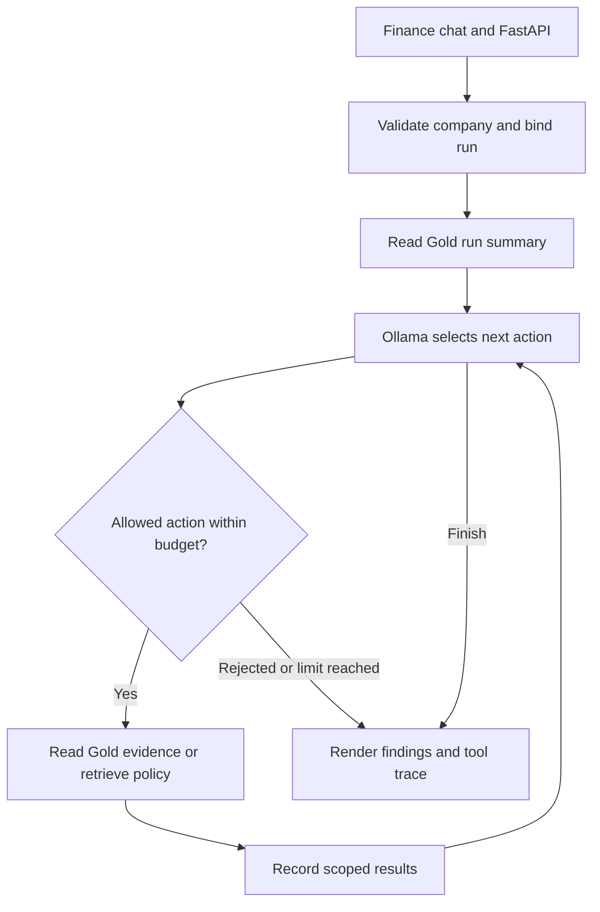
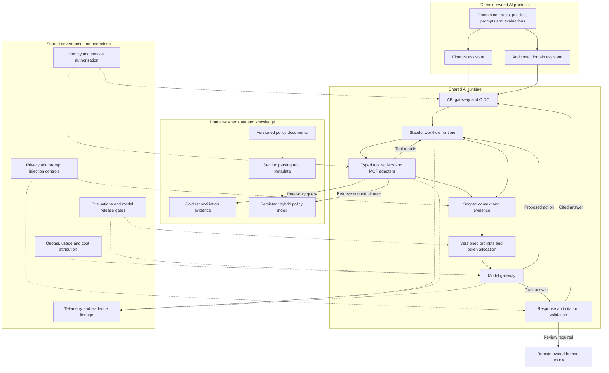

# AI Platform

The reference implementation is a Finance assistant for bank statement reconciliation. It explains how general ledger (GL) entries were classified, identifies shared statement candidates, retrieves versioned policy guidance, and drafts handoff notes for Finance Operations.

## Implemented reference flow

| Capability | Implementation |
| --- | --- |
| Finance chat | FastAPI serves `/chat` and `POST /v1/finance/chat`. Routes cover GL ID listing and search, entry explanations, run summaries, policy questions, investigations, and handoff drafts. |
| Structured evidence | Spark reads Gold Delta tables on MinIO. Lookups apply company and run scope and return reconciliation status, statement transaction IDs, and claimant GL IDs. |
| Policy retrieval | FIN-REC-001 is versioned Markdown in MinIO. Known rules support exact section lookup. Policy Q&A uses section embeddings from Ollama's `embeddinggemma` and an in-process index. Citations include policy version and section. |
| Bounded investigation | Python retrieves the scoped Gold summary first. Ollama selects read-only follow-up actions using the evidence returned so far. The workflow allows two follow-up lookups and renders the answer from tool results. |
| Trace and handoff | Investigation responses include supporting records, citations, a tool trace, and a stop reason. The statement lookup can produce a Finance Operations draft for manual review. |



### Demo acceptance check

Ask **What exceptions should I review in this run, and why?** for **Demo Finance**. The verified `silver-demo-001` response reported eight GL entries, four `AMBIGUOUS` and four `UNMATCHED`. The trace showed the Gold summary, a successful drill-down into `TX-001` with four claimant GL IDs, and a lookup of FIN-REC-001 §3.4. The workflow stopped at its two-follow-up lookup limit. The unmatched entries were counted and remain available for separate investigation.

Treat §3.4 as related guidance for this example. Its manual-review clause describes multiple statement transactions satisfying a match. The demonstrated exception involves one statement transaction shared by four GL entries.

## Developer setup

1. Open the repository from Ubuntu WSL in VS Code. Keep the checkout in the WSL filesystem. Enable Docker Desktop integration for that distro and start its Kubernetes cluster. Check connectivity with `docker info` and `kubectl --context docker-desktop get nodes`. If kubectl is installed only on Windows, run the Kubernetes commands from PowerShell with the same context.
2. From the repository root, create a Python 3.11 environment and select its interpreter in VS Code.

   ```bash
   cd ai-platform
   python3.11 -m venv .venv
   source .venv/bin/activate
   python -m pip install -r requirements.txt
   java -version
   ```

   Use JDK 17 for local Spark. If the Spark adapter expects baked JARs under `/opt/spark-jars`, use the container for Gold integration tests or configure the adapter to use the equivalent local JAR directory. Starting FastAPI alone does not verify Spark or MinIO access.

3. Prepare the data dependencies. Run the Data Platform reconciliation flow to publish Gold for the same `DEMO_RUN_ID` used by the AI deployment. Upload the policy Markdown to MinIO at the configured bucket and key. The API credentials need read access to Gold Delta logs and data files and to the policy object.

## Deploy to Docker Desktop Kubernetes

Run these commands from the repository root in a Bash shell with Docker and kubectl configured. Locate the manifests with `rg --files ai-platform -g '*.yaml' -g '*.yml'`. Set `manifest` and `ollama_manifest` to the actual paths in your checkout before running the commands.

1. Create the namespace and load a Git-ignored env file containing the MinIO S3 credentials (`AWS_ACCESS_KEY_ID` and `AWS_SECRET_ACCESS_KEY`).

   ```bash
   kubectl --context docker-desktop create namespace enterprise-ai \
     --dry-run=client -o yaml | kubectl --context docker-desktop apply -f -
   kubectl --context docker-desktop -n enterprise-ai create secret generic finance-gold-reader \
     --from-env-file=ai-platform/.minio.env --dry-run=client -o yaml |
     kubectl --context docker-desktop -n enterprise-ai apply -f -
   ```

2. Deploy the repository's Ollama manifest in `enterprise-ai` and wait for its deployment. Use the persistent model volume and the in-cluster Service named `ollama` on port 11434. Pull both models into Ollama.

   ```bash
   kubectl --context docker-desktop -n enterprise-ai apply -f "$ollama_manifest"
   kubectl --context docker-desktop -n enterprise-ai rollout status deployment/ollama --timeout=300s
   kubectl --context docker-desktop -n enterprise-ai exec deployment/ollama -- ollama pull embeddinggemma
   kubectl --context docker-desktop -n enterprise-ai exec deployment/ollama -- ollama pull qwen2.5:1.5b
   ```

3. Configure the API Deployment in `platform.yaml`. Use a MinIO endpoint reachable from the pod and set `GOLD_SOURCE_INSTANCE` to the source identifier stored in Gold.

   | Settings | Value or source |
   | --- | --- |
   | `MINIO_ENDPOINT`, `GOLD_BUCKET`, `DEMO_RUN_ID`, `GOLD_SOURCE_INSTANCE` | Source environment and published Gold run. The reference run is `silver-demo-001` in bucket `gold`. |
   | `GOLD_ALLOWED_COMPANIES`, `FINANCE_POLICY_COMPANIES` | `Demo Finance` for the reference run |
   | `FINANCE_POLICY_OBJECT_KEY`, `FINANCE_POLICY_VERSION` | `bank-statement-reconciliation-policy.md`, `1.0.0` |
   | `FINANCE_POLICY_SHARED_CANDIDATE_HEADING` | `3.4 Ambiguous match or account mapping` |
   | `OLLAMA_BASE_URL`, `POLICY_EMBEDDING_MODEL`, `OLLAMA_POLICY_MODEL` | `http://ollama:11434`, `embeddinggemma`, `qwen2.5:1.5b` |
   | API credentials | Deployment `envFrom.secretRef` points to `finance-gold-reader`. |

4. Build a fresh image and set the API container's `image:` in the manifest to the tag printed below. For a local image, use `IfNotPresent` and ensure the cluster node can see the image. If it cannot, push to a registry accessible to the cluster and use that image reference in the manifest.

   ```bash
   tag="enterprise-ai-platform:dev-$(date +%Y%m%d%H%M%S)"
   docker build -t "$tag" ./ai-platform
   printf '%s\n' "$tag"
   ```

   After saving the image tag in the manifest, apply it and wait for the rollout.

   ```bash
   kubectl --context docker-desktop apply -f "$manifest"
   kubectl --context docker-desktop -n enterprise-ai rollout status deployment/ai-platform --timeout=300s
   ```

5. Forward the service in a separate terminal, then verify startup and the investigation path. Open [Finance chat](http://127.0.0.1:18001/chat) to test in the browser.

   ```bash
   kubectl --context docker-desktop -n enterprise-ai port-forward svc/ai-platform 18001:8000
   ```

   ```bash
   curl -fsS http://127.0.0.1:18001/healthz
   curl -fsS --max-time 180 http://127.0.0.1:18001/v1/finance/chat \
     -H 'Content-Type: application/json' \
     -d '{"company":"Demo Finance","message":"What exceptions should I review in this run, and why?"}'
   ```

   Check the response against the demo acceptance check above. If the container restarts before becoming ready, inspect the previous API process logs with `kubectl --context docker-desktop -n enterprise-ai logs <pod-name> -c api --previous`.

## Target architecture

The target design shares orchestration, model access, and governance across domains. Each domain owns its data contracts, tools, policies, prompts, evaluation cases, and review queue.



## Roadmap

| Priority | Planned work | Acceptance check |
| --- | --- | --- |
| 1. Finance coverage | Add scoped drill-down for unmatched entries, distinguish shared statement claims from multiple eligible statement candidates, and route each to applicable policy. | Both ambiguity patterns and unmatched entries have distinct evidence-backed explanations. |
| 2. Evaluation and audit | Add regression cases for factual grounding, citations, scope, rejected actions, and budget exhaustion. Instrument requests and tool calls with OpenTelemetry and correlate evidence lineage. | CI detects regressions and an operator can trace an answer to its source evidence and lookup outcomes. |
| 3. Knowledge retrieval | Persist a versioned, metadata-filtered index and evaluate hybrid keyword/vector ranking. Keep exact clause lookup for known rules. | Index refresh publishes a new version and retrieval respects company and policy version. |
| 4. Identity and privacy | Add gateway OIDC, per-user company entitlements, service identities, managed secrets, and tests for injection and sensitive-data exposure. | Cross-company requests are denied and access decisions are auditable. |
| 5. Shared runtime and model governance | Extract reusable typed tools and a provider-neutral model gateway for Ollama and approved hosted models. Adopt LangGraph when workflow state must persist across requests, and add MCP adapters where external tool interoperability is needed. Version prompts and model configuration with CI gates and rollback. | A second domain registers its own assets and runs through the shared controls. |
| 6. FinOps and human review | Add token limits, quotas, rate cards and usage attribution. Add a review queue with approval decisions and an audit trail. | Operators can attribute cost by domain and reviewers can record a disposition for a flagged exception. |
