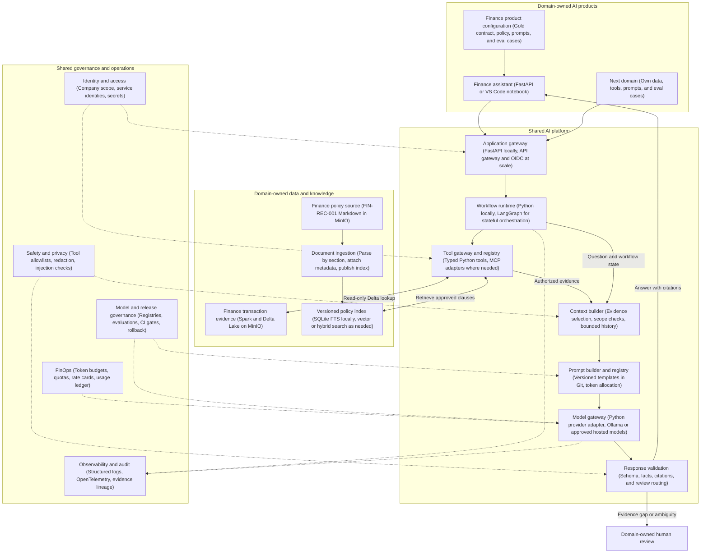

# AI platform starter

Merge this directory into the existing repository's `ai-platform/` directory.
Review any existing files with the same names before copying.

The shared FastAPI runtime loads and validates domain product manifests at
startup. The Finance manifest declares intended tool names, company scope,
and budgets. This milestone validates configuration and serves a health
check. Authorization and budget enforcement land with the first tool and
model integrations. The empty model allowlist means model selection is pending.



## Docker Desktop Kubernetes smoke test

From the extracted `ai-platform/` folder, with Docker Desktop and its
Kubernetes cluster running:

```bash
kubectl config get-contexts
kubectl --context docker-desktop get nodes
docker build -t enterprise-ai-platform:0.1.0 .
kubectl --context docker-desktop apply -f deploy/k8s/platform.yaml
kubectl --context docker-desktop -n enterprise-ai rollout status deployment/ai-platform --timeout=120s
kubectl --context docker-desktop -n enterprise-ai port-forward service/ai-platform 18000:8000
```

In another terminal, run `curl http://127.0.0.1:18000/healthz` or open that URL
in a browser. Expect `{"status":"ok","registered_products":1}`.

The manifest assumes Kubernetes can see the Docker-built image. If a pod shows
`ErrImageNeverPull`, run `kubectl --context docker-desktop -n enterprise-ai describe pods`
to check the event. If the image is absent from the node, load it into your
cluster's image store or push it to a registry reachable by the node, then
update the image reference and pull policy accordingly.

## Next increment

Register the read-only Gold lookup as the first tool. Add policy retrieval,
context assembly, prompt rendering, model access, and governance enforcement
as the workflow takes shape.
