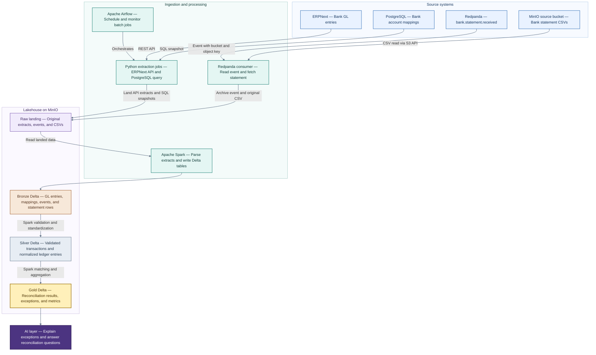

# Data platform

Target Azure: ADF/Event Hubs -> company-isolated ADLS Gen2 -> Databricks/Delta Bronze, Silver, Gold -> Unity Catalog/Databricks SQL/Power BI, with Purview, MDM and security as cross-cutting capabilities.

**Included bootstrap:** synthetic posted GL lines from two fictional companies; a minimal DuckDB-based demonstration writes raw Bronze, validated Silver and aggregated Gold Parquet outputs. It is deliberately **not** the complete finance star schema, a Delta Lake implementation, or an enterprise consolidation engine.

Run from repository root:

```bash
python -m data_platform.demo
python -m pytest data-platform/tests -q
```

Outputs are created under `outputs/data-platform/` (gitignored). Next labs: schema drift and quarantine, incremental loads and replay, account mapping, SCD2, `Fact_GL_Transaction`, conformed dimensions, reconciliation, governed EBITDA definition and domain policies.

## Local reconciliation sources

[Set up ERPNext, PostgreSQL, Redpanda, MinIO and Airflow ](source-setup/README.md) for the bank reconciliation demo.

## Data Layer 


### Bronze ingestion setup

Airflow runs on the dev PC. ERPNext, PostgreSQL, MinIO, and Redpanda run on the source host.

- [ ] **Create the MinIO buckets.** Keep incoming CSVs in `bank-statements`, archive original extracts, events, and CSVs in `raw-landing`, and store Delta tables in `bronze`.
- [ ] **Verify source access.** From the ingestion runtimes, read an ERPNext GL entry, query PostgreSQL’s `bank_account_mapping`, fetch `statement-001.csv` through the MinIO S3 API, and read an event from Redpanda’s `bank.statement.received` topic.
- [ ] **Validate Spark and Delta Lake.** Write a small Delta table to MinIO and read it back.
- [ ] **Build and test the batch DAGs.** Create one Airflow DAG for a date-bounded ERPNext bank ledger extract and another for a PostgreSQL account mapping snapshot. Run both manually before enabling schedules.
- [ ] **Build and test the statement consumer.** Read the Redpanda event, fetch the referenced CSV, archive both originals, and write the event and statement rows to Bronze. Commit the Kafka offset after all required writes succeed.
- [ ] **Verify Bronze and replay.** Check all four Bronze tables. Replay the same statement event and confirm `statement-001` still has exactly two transaction rows.

### Silver validation

- [ ] Normalize the bank and ERP ledger records. Verify that the ₹10,000 withdrawal matches the ERPNext bank ledger credit and that the ₹250 bank charge remains unmatched.
