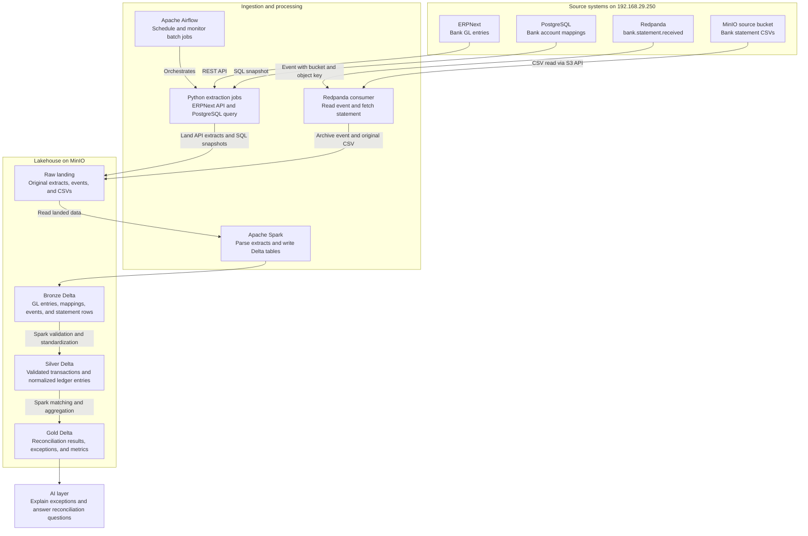

# Data platform

Target Azure: ADF/Event Hubs -> company-isolated ADLS Gen2 -> Databricks/Delta Bronze, Silver, Gold -> Unity Catalog/Databricks SQL/Power BI, with Purview, MDM and security as cross-cutting capabilities.

**Included bootstrap:** synthetic posted GL lines from two fictional companies; a minimal DuckDB-based demonstration writes raw Bronze, validated Silver and aggregated Gold Parquet outputs. It is deliberately **not** the complete finance star schema, a Delta Lake implementation, or an enterprise consolidation engine.

Run from repository root:

```bash
python -m data_platform.demo
python -m pytest data-platform/tests -q
```

Outputs are created under `outputs/data-platform/` (gitignored). Next labs: schema drift and quarantine, incremental loads and replay, account mapping, SCD2, `Fact_GL_Transaction`, conformed dimensions, reconciliation, governed EBITDA definition and domain policies.

## Local reconciliation sources

[Set up ERPNext and PostgreSQL](source-setup/README.md) for the bank reconciliation demo.

## Data Layer 

